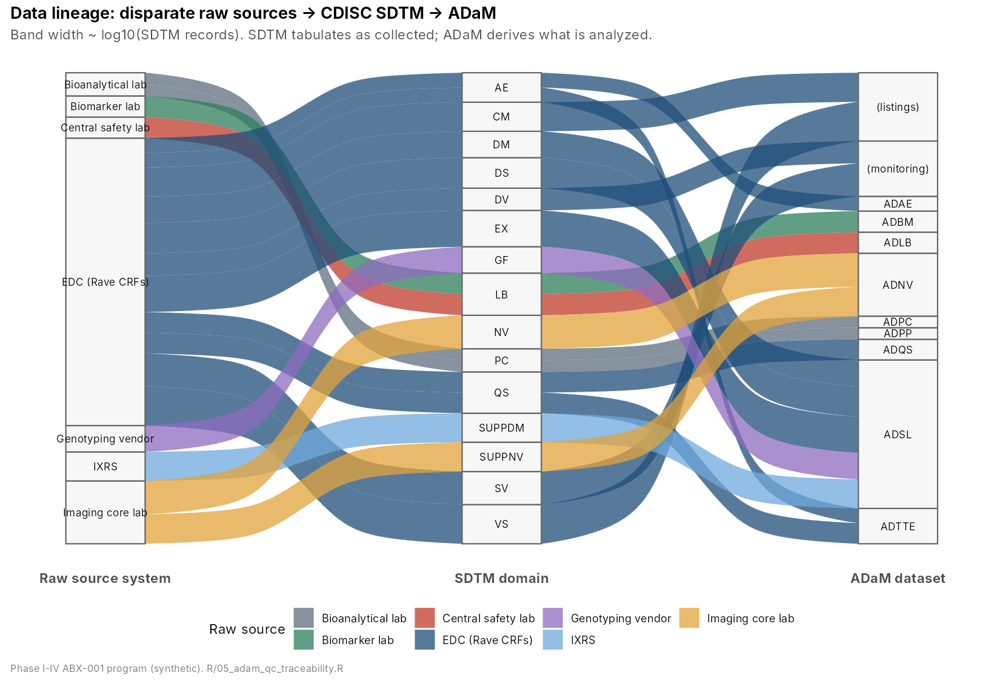

# From Raw Clinical Data to CDISC SDTM/ADaM: A Blood-Based Biomarker Alzheimer's Disease Program (Phase I-IV) in R



## Objective
Build an end-to-end, regulatory-style clinical data pipeline in R that **ingests disparate raw sources** (EDC, IXRS, central safety lab, specialty plasma-biomarker lab, APOE genotyping, amyloid-PET imaging core, bioanalytical PK lab), **maps them to CDISC SDTM**, **derives CDISC ADaM**, and uses ADaM alone to answer the key clinical questions of a four-study program for a fictional anti-amyloid antibody, **ABX-001**. It also provides centralized monitoring dashboards and a patient profile viewer. The emphasis is on mastering SDTM and ADaM.

## Methods
| Layer | What was done | Code |
|---|---|---|
| **Raw sources** | 1,128 synthetic participants in 4 studies (Phase I SAD/MAD n=48; Phase II dose-ranging n=180; Phase III pivotal n=600; Phase IV real-world n=300), 20 files in 7 vendor formats with real-world defects: vendor keys, mixed units, partial dates, `<LLOQ`, QC failures, free-text AEs, 3 sites with planted quality problems | `R/01` |
| **SDTM** (SDTMIG v3.4 conventions) | 17 domains: TS, TV, DM, SUPPDM, SV, EX, CM, AE, DS, DV, VS, LB (safety + biomarkers), QS, GF (APOE), NV (amyloid PET), SUPPNV, PC. ISO 8601, controlled terminology, MedDRA/WHODrug coding, SAS XPT v5 + CSV, source-to-target mapping spec | `R/02`, `specs/sdtm_mapping_spec.csv` |
| **SDTM QC** | 106 Pinnacle 21-style conformance checks | `R/03` |
| **ADaM** (ADaMIG v1.3 conventions) | ADSL, ADAE (OCCDS), ADLB, ADBM, ADQS, ADNV, ADTTE, ADPC, ADPP (BDS). Baseline/CHG, derived parameters (CDR-SB, Abeta42/40), partial-date imputation, TEAE flags, ARIA custom queries, BLQ rules, NCA | `R/04`, `specs/adam_spec.csv` |
| **ADaM QC** | 48 logic and traceability checks, including `SRCSEQ` round-trip for every non-derived value and **independent double programming** of the primary endpoint from raw EDC (4,433 values, 0 mismatches) | `R/05` |
| **Analyses** | Power model (PK), ANCOVA on log biomarker ratio, **MMRM** (unstructured covariance, `nlme::gls`), Kaplan-Meier/Cox, ROC with two-cutoff approach, proportion of treatment effect explained, eDISH | `R/06` |
| **Monitoring** | 9 Key Risk Indicators per site with robust z-scores (ICH E6 risk-based monitoring), patient profiles, **Shiny review hub** (6 tabs) | `R/07`, `R/08`, `app/app.R` |

## Results (all values computed from ADaM; see `output/key_results.json`)
| Phase / question | Finding |
|---|---|
| **I** Is PK dose-proportional? | Yes. Power-model slope for Cmax **1.01** (90% CI 0.94-1.09), AUC **1.00**; median half-life **28 days** |
| **II** Does it engage the target? | Plasma p-tau217 at Week 52 was **42% lower than placebo** at the high dose and 22% lower at the low dose (p < 0.001); GFAP fell; NfL did not change |
| **III** Does it slow decline? | CDR-SB change at Week 78: **-0.50 vs placebo** (95% CI -0.73 to -0.27, p < 0.001), **28% slowing**; ADAS-Cog13 -1.99 (p < 0.001). Amyloid PET fell **49 Centiloids**; **49%** became amyloid-negative |
| **III** ARIA risk | ARIA-E: **6.8%** (non-carriers), **18.9%** (APOE e4 homozygotes) on 1000 mg vs 1.7% on placebo; HR 6.6 (95% CI 2.8-15.6) vs placebo; most cases in the first 6 months |
| **IV** Can a blood test replace PET? | p-tau217 vs amyloid PET: **AUC 0.93** (0.90-0.96), better than Abeta42/40 (0.90). A two-cutoff rule classified 70% of patients with **93% accuracy**; 30% fell in the intermediate zone and would need PET/CSF |
| Biomarker vs clinical benefit | Greater p-tau217 reduction went with less CDR-SB decline (r = 0.24); p-tau217 change explained about 45% of the treatment effect |
| Safety and data quality | 1 potential Hy's law case flagged for review. Monitoring caught all 3 planted problem sites: missing data/late entry (3018), AE under-reporting (3007), and implausibly stable MMSE scores (3025). All 106 SDTM and 48 ADaM checks passed |

## Key takeaways (plain language)
- **CDISC is the common language of drug trials.** SDTM stores what was collected, in standard tables. ADaM stores what is analyzed, and every analysis number can be traced back to its source. Regulators require both.
- **The drug (simulated) worked modestly**: about a quarter slower decline in memory and daily function over 18 months, with clear removal of brain amyloid.
- **A simple blood test (p-tau217) tracked brain amyloid well.** It could replace most expensive PET scans for diagnosis and could monitor whether the drug is working.
- **The main risk is brain swelling (ARIA)**, which is highest in people with two copies of the APOE e4 gene. That supports genetic testing and MRI monitoring early in treatment.
- **Central monitoring finds problem sites from the data alone**, so monitors can focus their visits where the risk is.

> **All data are synthetic** (seeded simulation). Numbers show methods, not real drug performance.

---
### Repository structure
```
R/             00_setup.R ... 08_patient_profiles.R, utils_patient_profile.R  (each script opens with a Step | Rationale | Interpretation table)
notebooks/     00_CDISC_SDTM_ADaM_walkthrough.ipynb + one executed R-kernel notebook per script
app/app.R      Shiny hub: Overview | Central monitoring | Safety | Efficacy & biomarkers | Patient profile | CDISC explorer
data/raw/      original disparate source files (EDC, IXRS, labs, genotyping, imaging, bioanalytical)
data/sdtm/     17 SDTM domains (.csv + .xpt)          data/adam/   9 ADaM datasets (.csv + .xpt)
specs/         sdtm_mapping_spec.csv, adam_spec.csv    docs/        CDISC_SDTM_ADaM_Guide.md (learning guide + self-test)
figures/       24 PNG figures                          output/      tables/, qc/, monitoring/, key_results.json
tools/         notebook builders                       run_all.R, install_packages.R
```
### Run it
```r
source("install_packages.R")   # once
source("run_all.R")            # about 1 minute: raw -> SDTM -> QC -> ADaM -> QC -> analyses -> monitoring
shiny::runApp("app")           # dashboard and patient profile viewer
```
Production note: the derivations are written in dplyr, and each step names its pharmaverse `{admiral}` equivalent; `{sdtm.oak}`, `{metacore}` and `{xportr}` are the production choices for mapping and define.xml.
